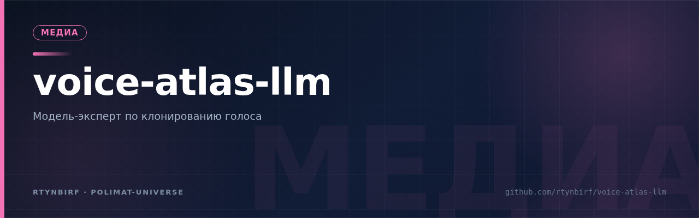
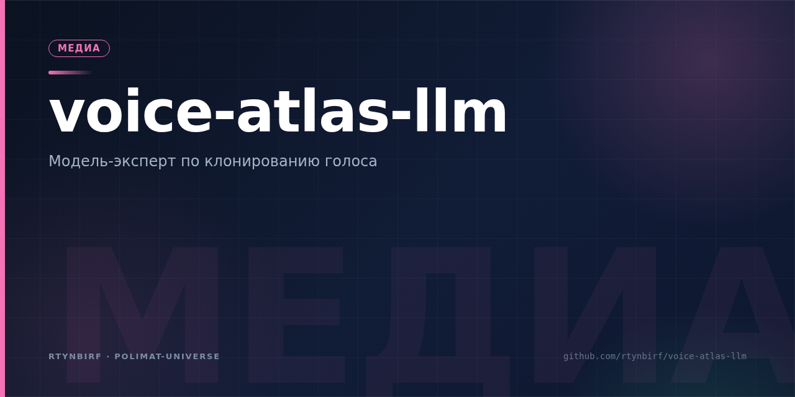

<div align="center">
  <picture>
  <source media="(prefers-color-scheme: dark)" srcset="assets/forge-banner-voice-atlas.svg" />
  
</picture>
</div>

# Атлас-LLM · voice-atlas-llm

<p align="center"></p>


[](./LICENSE) [](./README.md) [](./README.md) [](./README.md)

**LLM-эксперт по клонированию голоса, обученный на Техническом атласе 2026.**
Модель, которая знает: четыре слоя дизентанглмента, таксономию TTS/VC/SVC/SVS,
20 поколений технологий, гейты качества, семь законов «не испорти оригинал»
и правки независимого аудита (Voice Audit Pack 0.1.1).

> Копия — наследник, а не двойник. Это правило стоит и в атласе, и здесь:
> LoRA-адаптер надёжно крепится к базовой модели, гейты валидации
> обязательны, а неснятые вопросы модель честно помечает как непроверенные.

> **Волна «RAFT-Гибрид» (2026-11-10): F1 ×2 — закрыт разрыв train/inference по мировой практике.**
> Вэб-разведка практик (`docs/TRENDS_2026-11-10.md`): RAFT (Berkeley, arXiv:2403.10131)
> + NEFTune (arXiv:2310.05914). v1-v3 учились всплоту, а инференс всегда грундит top-3
> ретривера — теперь модель учится на том же распределении: те же 308 пар v3, каждая
> со справкой (60% реальный top-3 / 40% «память» на чужих чанках, детерминизм sha256,
> оракул измеряется keyword_coverage, не генерируется LLM). Единый формат-модуль:
> train == инференс байт-в-байт. Прогон 60 шагов / 26 окон с атомарным resume.
> **Честный A/B на том же вале-30: F1 0.564 — лучший из четырёх**
> (v1 0.211 → v2 0.179 → v3 0.285 → **v4 0.564**, +98% к v3); kw 0.590;
> попарно v4 > v3 на 22/30. Отчёт: `evaluation/report_v4_on_val30.json`;
> методология — `docs/MODEL_CARD.md` §7; состав — `docs/DATA_CARD.md` §0.
>
> **Волна «Добивание» (2026-11-09): регресс генерации вылечен — корпус v3.**
> Диагноз v2 (авто-таблицы 53.5% train смещали адаптер) → лечение: кэп table_qa
> **25.7%**, +22 процедурных QA (этапы универсального алгоритма, эталон-псевдокод),
> +43 парафраза, вал заморожен = вале-30 v2 (A/B честный). Полный прогон v3 —
> 60 шагов / 3 эпохи / 10 окон с чекпоинт-резюмом. **Честный A/B на одном вале-30:
> F1 v3 = 0.285 — лучший из трёх** (v1 0.211 → v2 0.179 → **v3 0.285**, +35% к v1,
> +59% к v2); keyword_coverage 0.290. Гипотеза MODEL_CARD §3 подтверждена.
> Отчёт: `evaluation/report_v3_on_val30.json`; состав v3 — `docs/DATA_CARD.md` §0.
>
> **Волна «Гибрид» (2026-10-29):** корпус v2 — 163 → **383 пары**
> (авто-QA из таблиц атласа и семи законов), сплит строго по главам
> (близнецов 0), ретривер v2 с заголовками в индексе — RAG-покрытие
> контекста **0.833** (было 0.49). Полный прогон v2 (3 эпохи, val_loss 2.769,
> окна с резюмом); его репро-проверка 2026-11-09 совпала байт-в-байт
> (val_loss и F1 — до 14 знаков). Подробности — `docs/DATA_CARD.md`, §0.

---

## Что внутри

```
data/
  atlas/            корпус: 19 глав атласа + глава 20 «Ревизия аудита» (источник знаний)
  curated/          кураторские QA-пары (142) + системный промпт
  auto_qa.py        авто-QA v2: таблицы (238) / законы (14) / термины — fail-loud
  build_dataset.py  сборщик датасета: куратор + глоссарий + авто-QA → валидация → train/val
  dataset/          собранный датасет v2 (383 пары; train 353 / val 30 по главам)
training/
  prompt_format.py  универсальный шаблон «Вопрос/Ответ» с маской лосса
  train_lora.py     LoRA/QLoRA-файнтюн (torch+peft, GPU bf16 / CPU smoke)
  merge_lora.py     слияние адаптера с базой → автономная модель
  configs/          smoke-tiny.yaml (CPU-проверка), qwen2.5-0.5b-ru.yaml (v1)
                    и qwen2.5-0.5b-atlas-v2.yaml (полный прогон на корпусе v2)
inference/
  retriever.py      TF-IDF RAG по корпусу атласа (офлайн, char_wb n-граммы)
  chat_cli.py       чат: --dry (только RAG) / база+RAG / база+адаптер+RAG
evaluation/
  eval_qa.py        гейт качества: token_f1, keyword_coverage, честность
tests/              pytest: датасет, промпт-формат, RAG
scripts/            код реально исполненных рецептов (на ветке proven-recipes)
.github/workflows/  CI: сборка датасета + тесты + RAG-smoke
```

## Быстрый старт

```bash
pip install -r requirements.txt          # ядро (RAG, датасет, CI)
python data/build_dataset.py             # собрать датасет
python inference/retriever.py "чем SVC отличается от SVS"   # RAG без моделей
python inference/chat_cli.py --dry "пороги качества SIM WER" # сухой чат
```

## Обучение

**Smoke-проверка пайплайна (CPU, ~2 минуты):**
```bash
pip install -r requirements-ml.txt
python training/train_lora.py --config training/configs/smoke-tiny.yaml
```

**Полное обучение Атлас-LLM на CPU (~85 мин на 2 ядрах / 4 ГБ RAM — проверено здесь):**
```bash
python training/train_lora.py --config training/configs/qwen2.5-0.5b-ru-cpu.yaml
```

**То же на RTX 3060 12 ГБ / Colab T4 (~25–40 минут):**
```bash
python training/train_lora.py --config training/configs/qwen2.5-0.5b-ru.yaml
```
База: `Qwen/Qwen2.5-0.5B-Instruct` (Apache-2.0). LoRA r=16, лосс только на ответе
(masked_lm_loss + чанкинг CE — см. docs/training_report.md),
hold-out val сплит, косинусный LR-расписание, ранние логи — по духу главы 12 атласа.

**Чат с обученной моделью (RAG + LoRA):**
```bash
python inference/chat_cli.py \
  --adapter models/atlas-qwen-0.5b \
  "какие вокодеры подходят для пения?"
```

**Оценка (гейт качества):**
```bash
python evaluation/eval_qa.py --adapter models/atlas-qwen-0.5b --max-samples 40
```

## Дорожная карта (по главам атласа)

| Ступень | Статус | Что даёт |
|---|---|---|
| 1. RAG-клон (этот репозиторий) | ✅ готово | ожидание 75–85% по лестнице гл. 10 (не калибровано), 0 GPU |
| 2. LoRA 0.5B (полные прогоны v1+v2) | ✅ готово: адаптеры v1 (`908f578`) и v2 (`models/atlas-qwen-0.5b`); честный A/B на вале-30 — см. MODEL_CARD §3 | v2: RAG-покрытие 0.833, F1 генерации 0.179 (регрессия против v1 0.211 — лечится корпусом v3) |
| 3. DPO на парах «верно/карикатура» | 📋 roadmap | вкус ответов, борьба с карикатурой (закон 3) |
| 4. QLoRA 7–8B (Qwen2.5-7B) | 📋 roadmap | полнота рассуждений, 12 ГБ VRAM |
| 5. Голосовой контур: Seed-VC/RVC-адаптеры | 📋 гипотеза (глава 20) | контроллер сохранения оригинала |

## Честный статус

- **Полное обучение v2 выполнено на этом железе** (CPU, 3 эпохи, 69 шагов,
  4860 с чистого времени в 11 окнах ≤7 мин с чекпоинт-резюмом — переживает любые
  перезапуски среды): адаптер `models/atlas-qwen-0.5b` — в репозитории.
- Гейт качества (честный A/B на одном вале-30, один RAG-контекст):
  v2 token_f1 0.179 / kw 0.232 против v1 0.211 / 0.229 — **расширение корпуса
  163→383 улучшило ретривер (0.49→0.833), но НЕ генерацию (F1 −15%)**; разбор и
  план лечения (корпус v3: кэп авто-таблиц, парафразы, рецепты) — MODEL_CARD §3.
  Это ступень 2 (RAG+LoRA 0.5B), не финал — далее корпус v3, DPO, QLoRA 7–8B.
- Пороги метрик из атласа (SIM ≥ 0.80, WER ≤ 5% и т.д.) относятся к аудио-копиям;
  для текстовой модели здесь свои метрики (token_f1 / keyword_coverage), а
  универсальные пороги калибруются — ровно как требует глава 20.
- Лицензии инструментов, упомянутых в корпусе, проверяйте по первоисточникам:
  атлас содержит правку аудита (Seed-VC — GPL-3.0, а не MIT).
- Политика движка — «эхо» (см. THREAT_MODEL T3 и docs/audit/VFE_050_REVIEW.md):
  без разрешительных процедур; единственный жёсткий гейт — неприкосновенность
  исходника; синтетика честно маркируется. Исполнительный контур фазы 4 —
  проверенный Voice Fidelity Engine 0.5.0 (41/41 тестов воспроизведены независимо).

## Источники

- Технический атлас 2026 (19 глав) — корпус `data/atlas/`
- Voice Audit Pack 0.1.1 — CLAIMS_LEDGER (глава 20 ревизии)
- Voice Fidelity Engine 0.3.0 — реестр компонентов

## Документация

| Документ | О чём |
|---|---|
| `docs/MISSION.md` | устав: голос, который переживёт создателя — для тех, кто придёт после |
| `docs/SPEC_v0.3.md` | прототип ТЗ: требования, критерии приёмки, вне scope |
| `docs/ROADMAP_v2.md` | дорожная карта v2.0: доверие к измерениям → знание → вкус → масштаб → голос |
| `docs/EVALUATION_PLAN.md` | golden set 100+, абляция, антиутечка сплита, Judge-контур |
| `docs/THREAT_MODEL.md` | модель угроз: инъекции, отравление корпуса, закон 7, supply-chain |
| `docs/MODEL_CARD.md` / `docs/DATA_CARD.md` | карточки модели и данных |
| `docs/audit/SYNTHESIS.md` | антигаллюцинационный синтез внешних LLM-ревизий: вердикты с доказательствами |
| `docs/audit/VFE_050_REVIEW.md` | независимая ревизия Voice Fidelity Engine 0.5.0 (41/41 тестов в чистой среде, находки, эхо-политика) |
| `docs/WORKS.md` | хроника ТОЛЬКО проверенного: правило + полная цепочка Фаза 0 (замысел) → Фаза 9 (файл на ПК) + запретный список. Полная версия с кодом рецептов (`scripts/`) — на ветке `proven-recipes` |
| `docs/training_report.md` | отчёт о полном обучении (прогон 4) |
| `docs/architecture.md` · `docs/roadmap.md` (v1) · `docs/sources.md` | архитектура, роадмап v1, источники |

## Лицензия

MIT (код и датасет). Базовые модели сохраняют свои лицензии
(Qwen2.5 — Apache-2.0). Клонируйте голоса только с письменного согласия
носителя — закон 7 и глава 17 атласа.
